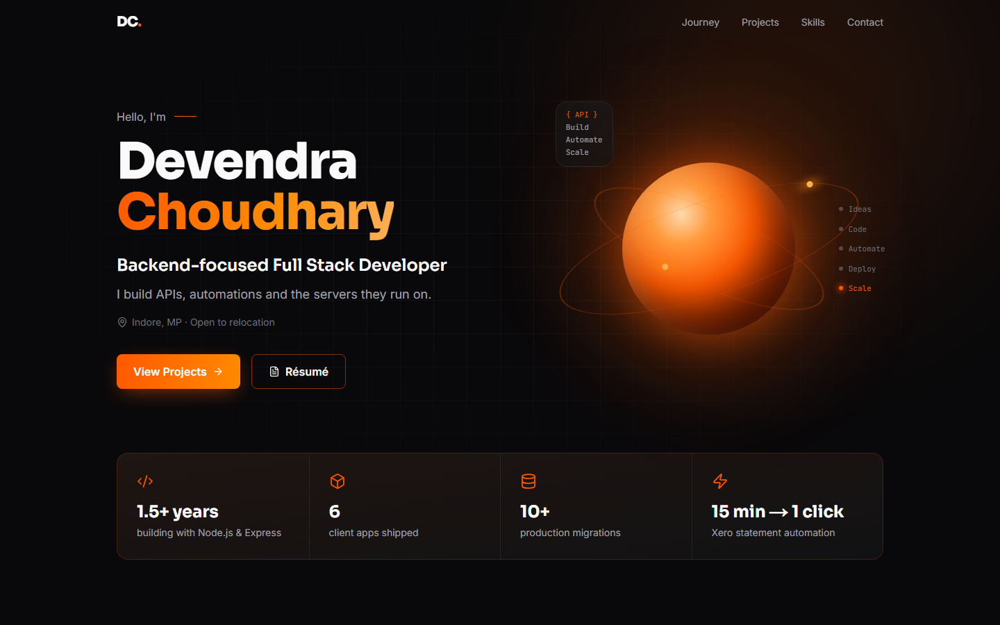

# Devendra Choudhary — Portfolio

Portfolio of a backend-focused full stack developer, built with Next.js and Tailwind CSS. A dark, warm-orange design with a glowing CSS orb, a scroll-told "journey" from first code to production, and project case studies drawn as animated data-flow diagrams — rich to look at, but fast and readable on any device.

**🔗 Live site → [devendra-choudhary.vercel.app](https://devendra-choudhary.vercel.app)**



## Highlights

- **Story-driven** — a "My Journey" timeline runs from first programs (BCA, 2020) to shipping production systems, and its line fills in as you scroll.
- **Data-flow case studies** — client work is under NDA, so each project shows how its data moves (e.g. cron → Xero invoice → payment → split → landlord bill) instead of screenshots.
- **Zero-JS visuals** — the hero orb, orbits, glows and flow animations are pure CSS/SVG: no WebGL, no animation libraries, and they work on phones.
- **Motion that never blocks** — no loader, scroll-jacking or custom cursor; content is readable instantly, and every animation turns off under `prefers-reduced-motion`.
- **Mostly server-rendered** — only the navbar, the scroll-reveal observer and the contact form ship client JavaScript.

## Tech stack

| Layer | Choice |
| --- | --- |
| Framework | Next.js 16 (App Router) · React 19 · TypeScript |
| Styling | Tailwind CSS v4 · Sora / Inter / JetBrains Mono |
| Icons | lucide-react |
| Content & auth | MongoDB Atlas · server actions · jose (JWT) · zod |
| Forms | Web3Forms |
| Hosting | Vercel |

## Running locally

```bash
git clone https://github.com/1devchoudhary/dev-portfolio.git
cd dev-portfolio
npm install
```

Create a `.env.local` with a free [Web3Forms](https://web3forms.com) key (only needed for the contact form):

```bash
NEXT_PUBLIC_WEB3FORMS_KEY=your_access_key_here
```

Then:

```bash
npm run dev     # http://localhost:3000
npm run build   # production build
```

## Editing content — the admin panel

Everything on the site (profile, stats, journey, projects, skills, links) and the résumé PDF can be edited at **`/admin`** — no code, commit, or deploy. Saving writes to MongoDB and regenerates the homepage within seconds; the Résumé button (`/resume`) serves the latest uploaded PDF.

- **Login:** a single admin password, checked with scrypt; session is a signed JWT in an httpOnly cookie (8 h). 5 failed attempts per IP lock logins for 15 minutes.
- **Safety:** every save is validated server-side (zod), uploads must be real PDFs ≤ 2 MB, and every server action re-checks the session.
- **Fallback:** without a database (or before the first save) the site renders the built-in content in `src/data/content.ts` and the PDF in `public/`.

### One-time setup

1. **MongoDB Atlas** (free M0): create a cluster and a database user; under *Network Access* allow `0.0.0.0/0` (Vercel has no fixed IPs); copy the connection string.
2. **Admin password:**
   ```bash
   npm run hash-password -- "a-long-password-you-will-remember"
   ```
   It prints `ADMIN_PASSWORD_HASH` and `SESSION_SECRET`.
3. **Environment variables** — add to `.env.local` for local use, and in Vercel → *Settings → Environment Variables* for production, then redeploy once:
   ```bash
   MONGODB_URI=mongodb+srv://...
   ADMIN_PASSWORD_HASH=...
   SESSION_SECRET=...
   # optional, defaults to "portfolio"
   MONGODB_DB=portfolio
   ```
4. Open `/admin`, sign in, press **Save changes** once to copy the built-in content into the database, and upload your résumé under the **Résumé** tab.

To change the password later, run `npm run hash-password` again, update `ADMIN_PASSWORD_HASH` (and `SESSION_SECRET` to sign out all sessions) in Vercel, and redeploy.

## Project structure

```
src/
├─ app/
│  ├─ admin/         # login, editor page, server actions (save, upload, auth)
│  ├─ resume/        # GET /resume — serves the uploaded PDF
│  └─ page.tsx       # homepage, reads content from the database
├─ components/
│  ├─ Admin/         # editor UI: tabs, list/chip editors, login form
│  ├─ Hero/          # intro, CSS orb, stats strip
│  ├─ Experience/    # "My Journey" story timeline
│  ├─ Projects/      # case studies + animated flow diagrams
│  ├─ Skills/ Contact/ Layout/ UI/
├─ data/content.ts   # built-in fallback content
├─ lib/              # db, store, schema (zod), session (jose), password, rate limit
└─ proxy.ts          # redirects /admin pages to login when signed out
scripts/hash-password.mjs
```

## Deployment

Deployed on Vercel; pushes to `main` deploy automatically. Set `NEXT_PUBLIC_WEB3FORMS_KEY` (and optionally `NEXT_PUBLIC_SITE_URL`) in the Vercel project's environment variables.

---

Built by [Devendra Choudhary](https://github.com/1devchoudhary) · [LinkedIn](https://www.linkedin.com/in/devendra-choudhary-2a538a1b3/)
